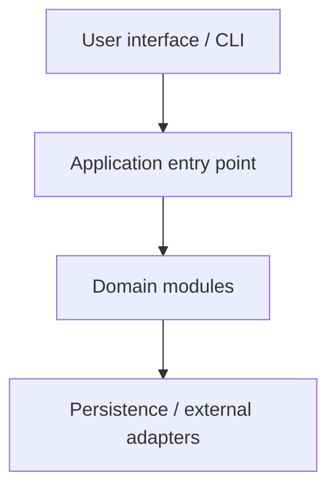
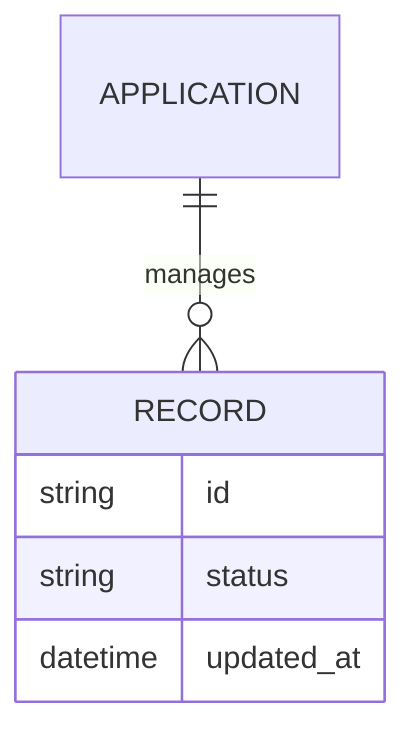
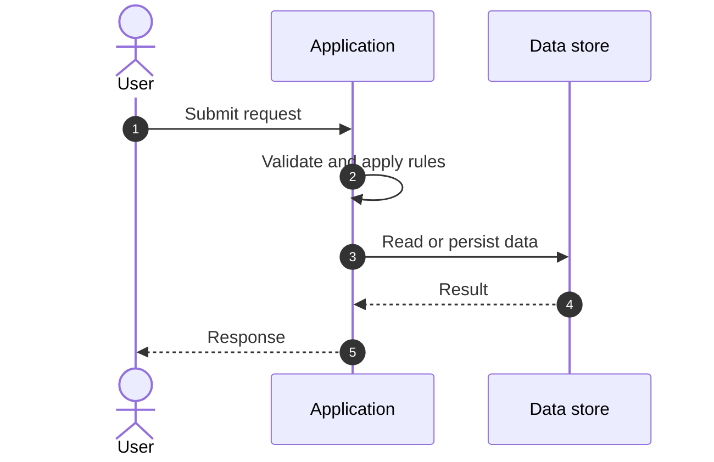

<div align="center">

**[English](README.md) | [Português](README_PT.md) | [Español](README_ES.md) (current)**

 

# Suite de Gestión Empresarial

*Aplicación Java modular de gestión empresarial organizada por dominios. Los paquetes incluyen análisis, activos, presupuesto, repositorios, validación, flujos de trabajo y eventos de auditoría.*

</div>

---

## 📑 Tabla de Contenidos

<details>
<summary>Haga clic para expandir o contraer esta sección</summary>

- [Descripción General](#descripción-general)
- [Arquitectura del Sistema](#arquitectura-del-sistema)
- [Tecnologías](#tecnologías)
- [Patrones de Diseño Aplicados](#patrones-de-diseño-aplicados)
- [Estructura del Proyecto](#estructura-del-proyecto)
- [Módulos del Sistema](#módulos-del-sistema)
- [Reglas de Negocio](#reglas-de-negocio)
- [Requisitos Funcionales](#requisitos-funcionales)
- [Requisitos No Funcionales](#requisitos-no-funcionales)
- [Modelo de Datos](#modelo-de-datos)
- [Flujos del Sistema](#flujos-del-sistema)
- [Seguridad](#seguridad)
- [Instalación y Ejecución](#instalación-y-ejecución)
- [Pruebas Automatizadas](#pruebas-automatizadas)
- [Métricas y Monitorización](#métricas-y-monitorización)
- [Limitaciones Conocidas](#limitaciones-conocidas)

</details>

## 🌟 Visión General

<details>
<summary>Haga clic para expandir o contraer esta sección</summary>

Aplicación Java modular de gestión empresarial organizada por dominios. Los paquetes incluyen análisis, activos, presupuesto, repositorios, validación, flujos de trabajo y eventos de auditoría.

### 🎯 Objetivos del Sistema

| Objetivo | Descripción |
|---|---|
| Core workflow | Aplicación Java modular de gestión empresarial organizada por dominios. Los paquetes incluyen análisis, activos, presupuesto, repositorios, validación, flujos de trabajo y eventos de auditoría. |
| Local development | Provides a runnable entry point and project-specific configuration. |
| Maintainability | Separates domain responsibilities into named modules. |

</details>

## 🏗️ Arquitectura del Sistema

<details>
<summary>Haga clic para expandir o contraer esta sección</summary>

### Module Diagram



### Architecture Layers


</details>

## 🛠️ Stack Tecnológico

<details>
<summary>Haga clic para expandir o contraer esta sección</summary>

<table>
<tr><th>Layer</th><th>Technology</th><th>Version</th><th>Purpose</th></tr>
<tr><td>Application</td><td>Java, Maven</td><td>See prerequisites</td><td>Runtime and user-facing workflows</td></tr>
<tr><td>Data</td><td>Repository-specific</td><td>See configuration</td><td>Persistence and exchanged data</td></tr>
</table>

</details>

## 🎨 Patrones de Diseño Aplicados

<details>
<summary>Haga clic para expandir o contraer esta sección</summary>

| Pattern | Where | Rationale |
|---|---|---|
| Layered responsibilities | Application modules | Keeps presentation, domain rules, and infrastructure concerns identifiable. |
| Repository or store | Persistence components, where present | Centralizes data access. |
| Validation | Input and domain boundaries | Rejects invalid data before processing. |

</details>

## 📁 Estructura del Proyecto

<details>
<summary>Haga clic para expandir o contraer esta sección</summary>

```text
enterprise-management-suite/
├── source and application modules
├── configuration and data
├── tests or verification tools, when present
├── README.md
├── README_PT.md
└── README_ES.md
```

</details>

## 📦 Módulos del Sistema

<details>
<summary>Haga clic para expandir o contraer esta sección</summary>

| Module | Responsibility |
|---|---|
| `Analytics` | Project component identified in the repository or its existing documentation. |
| `Assets` | Project component identified in the repository or its existing documentation. |
| `Budget` | Project component identified in the repository or its existing documentation. |
| `Enterprise records` | Project component identified in the repository or its existing documentation. |
| `Audit trail` | Project component identified in the repository or its existing documentation. |
| `Validation and workflows` | Project component identified in the repository or its existing documentation. |

</details>

## 💼 Reglas de Negocio

<details>
<summary>Haga clic para expandir o contraer esta sección</summary>

| ID | Rule | Enforcement |
|---|---|---|
| BR-01 | Validate input before changing stored state. | Application/domain validation. |
| BR-02 | Apply only workflows supported by the configured modules. | Relevant service or command handler. |
| BR-03 | Keep configuration and secrets environment-specific. | Runtime configuration. |

</details>

## ✅ Requisitos Funcionales

<details>
<summary>Haga clic para expandir o contraer esta sección</summary>

| ID | Requirement | Priority | Status |
|---|---|---|---|
| RF-01 | Start the application using the documented entry point. | 🔴 High | ✅ Implemented |
| RF-02 | Expose the workflows represented by the listed project modules. | 🔴 High | ✅ Implemented |
| RF-03 | Validate user or client input. | 🟡 Medium | ✅ Implemented |
| RF-04 | Provide project-specific configuration. | 🟡 Medium | ✅ Implemented |

</details>

## ⚡ Requisitos No Funcionales

<details>
<summary>Haga clic para expandir o contraer esta sección</summary>

| ID | Category | Requirement | Target |
|---|---|---|---|
| RNF-01 | ⚡ Portability | Run in the documented runtime. | Version in prerequisites |
| RNF-02 | 🔐 Security | Keep secrets out of source-controlled configuration. | Environment configuration |
| RNF-03 | 🧩 Maintainability | Keep modules and responsibilities discoverable. | Repository structure |
| RNF-04 | 💾 Reliability | Preserve data according to the configured storage. | Storage-specific |

</details>

## 🗄️ Modelo de Datos

<details>
<summary>Haga clic para expandir o contraer esta sección</summary>

### Diagrama Entidad-Relación



The exact persisted entities and formats depend on each module's implementation. See project source and configuration for the authoritative schema.

</details>

## 🔄 Flujos del Sistema

<details>
<summary>Haga clic para expandir o contraer esta sección</summary>

### Request lifecycle



</details>

## 🔐 Seguridad

<details>
<summary>Haga clic para expandir o contraer esta sección</summary>

### Controles Implementados

| Control | Implementation | Effect |
|---|---|---|
| Input validation | Application-specific validation | Reduces malformed input. |
| Secret configuration | Environment or local configuration, where supported | Keeps deployment settings configurable. |
| Local access boundary | Bind address and deployment configuration | Limits exposure according to the chosen environment. |

### Limitaciones de Seguridad Conocidas

> [!WARNING]
> Este README describe el estado del repositorio. Verifique la configuración del entorno antes de usar la aplicación con datos reales.

| Limitation | Risk | Mitigation path |
|---|---|---|
| Security depends on deployment configuration. | Accidental exposure or weak secrets. | Use strong secrets, HTTPS, and restricted network access where applicable. |
| Project-specific security review is outside this README. | Controls may not cover every deployment. | Review the source and deployment documentation before production use. |

</details>

## 🚀 Instalación & Ejecución

<details>
<summary>Haga clic para expandir o contraer esta sección</summary>

### Requisitos Previos

Java, Maven

### Compilación

```sh
mvn package
```

### Ejecución

```sh
mvn package
```

Use el comando siguiente desde la raíz del repositorio. Configure secretos y servicios externos según sea necesario.

Application address or entry point: `see project configuration`.

</details>

## 🧪 Pruebas Automatizadas

<details>
<summary>Haga clic para expandir o contraer esta sección</summary>

No se confirmó ningún comando de pruebas automatizadas en el README disponible. Revise la carpeta de pruebas y los scripts del proyecto antes de considerar validada la cobertura.

</details>

## 📊 Métricas & Monitorización

<details>
<summary>Haga clic para expandir o contraer esta sección</summary>

| Signal | Source |
|---|---|
| Application health | Application-specific health endpoint or process status, when available |
| Data volume | Configured database or storage |
| Diagnostics | Application logs and runtime output |

```sh
# Check the application process and its logs using the project's runtime tools
```

</details>

## ⚠️ Limitaciones Conocidas

<details>
<summary>Haga clic para expandir o contraer esta sección</summary>

> [!IMPORTANT]
> Este README describe el estado del repositorio. Verifique la configuración del entorno antes de usar la aplicación con datos reales.

| Category | Issue | Status |
|---|---|---|
| Environment | Runtime versions and optional integrations can vary by machine. | ⚠️ Verify locally |
| Data | Backup and retention depend on the selected storage. | ⚠️ Configure for deployment |
| Scope | This project README summarizes documented capabilities. | ✅ Documentation |

> [!TIP]
> Review the project configuration and deployment notes before connecting external systems or real data.

</details>

---

<div align="center">

### Suite de Gestión Empresarial

*Creado para flujos de trabajo prácticos y sostenibles.*

 

</div>
